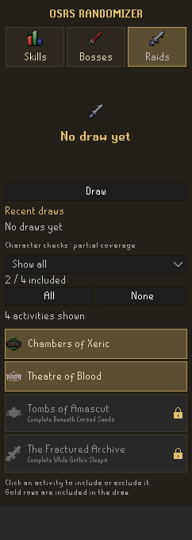

# OSRS Randomizer

A RuneLite side-panel plugin that picks your next skill, boss, raid or diary from your own selection.

## Features

- Compact Skills, Bosses, Raids and Diaries tabs with activity icons.
- Include or exclude activities; saved selections and All / None controls.
- One-click draws with a short animation and repeat protection. The last three results are avoided where the selection allows it.
- Five recent draws per category, saved separately for each character and restored after login. Repeat protection survives restarts.
- Character filtering, enabled by default: membership, supported quest gates and the Medium Wilderness Diary. Locked rows show a padlock and the missing requirement.

## Using the plugin

Open the OSRS Randomizer sidebar, select a category and click activities to include them. Gold rows are included. Click **Draw** to pick one activity.

Change **Available for my character** in the plugin's RuneLite settings. With this enabled, log into a character before drawing. Access checks update approximately every six seconds. Choices are preserved when an activity is temporarily blocked.

The filter has **partial coverage**. It checks membership and supported quest/diary gates, not every level, item, encounter unlock or combat requirement. A selectable activity is not a guarantee of access. See [supported requirements and sources](QUEST-REQUIREMENTS.md).

Draws made while logged out with the filter disabled are temporary. Logging in restores that character's saved history. Selections are shared within the RuneLite configuration profile; history is separate for each character.

## Development

Requires a JDK (tested with JDK 21; Java 11 bytecode target). The first build downloads public dependencies.

    ./gradlew test jar
    ./gradlew run

On Windows use gradlew.bat, or double-click Lancer-RuneLite.bat to launch the development client. For Jagex accounts, follow [RuneLite's official guide](https://github.com/runelite/runelite/wiki/Using-Jagex-Accounts).

Install OSRS Randomizer from RuneLite's Plugin Hub. New updates require Plugin Hub review before distribution. The built plugin JAR is not a standalone installer.

## Validation and data

51 automated tests cover selection persistence, draws, repeat protection, character gates, animation cancellation, and history restoration. The author has also confirmed history persistence and character filtering in the development client.

The plugin does not automate gameplay or make network requests. It reads character quest, diary and membership state through RuneLite's client API. Selection IDs and recent draw IDs are stored using RuneLite ConfigManager; history keys include the character's account hash. RuneLite's own configuration storage and sync behavior applies. No login credentials are read or stored by the plugin.

## License and credits

Code: [BSD 2-Clause](LICENSE), MarcanQc. Built from the [RuneLite example plugin](https://github.com/runelite/example-plugin).

OSRS activity art and the OSRS elements of the logo belong to their respective rights holders, including Jagex; the code license does not relicense that artwork. This is an unofficial fan project, not affiliated with Jagex or RuneLite.

[Guide en français](README.fr.md)

## 0.1.1 — The Fractured Archive
Adds the fourth raid with membership and While Guthix Sleeps checks, using the bundled generic raid icon. Existing saved selections stay unchanged: click The Fractured Archive or All in the Raids tab to include it. Fresh selections include all four raids. The introductory miniquest and other encounter-specific conditions are not checked.

## 0.1.2 — Achievement Diaries

The Diaries tab offers 48 region/tier objectives: twelve regions, each with Easy, Medium, Hard and Elite. Reward item icons match each region and difficulty (tiers 1–4). Selection, repeat protection and per-character history work as in the other categories.

With **Available for my character** enabled, non-members and completed diary tiers are excluded. Unread completion data stays blocked until synchronization. Supported base skill levels, quests (started or completed), combat levels and quest points are checked using tier rules adapted from RuneLite Diary Requirements. Missing requirements appear in the row and tooltip. Click the small **i** beside a diary to expand its missing requirements, current/required base levels and quest states. Tasks already completed by the character are skipped when evaluating their requirements. Temporary boosts are not considered. Items, precise partial-quest steps and other special unlocks are not comprehensively covered; eligibility is not a guarantee that every task is doable. Turning the filter off allows manual selection of any tier. Completing a tier never erases saved selections.
Version 0.1.2 uses the user-supplied Fractured Archive logo and Achievement Diary section icon. The logos are bundled at icon-sized resolutions (96 x 74 and 40 x 39 pixels), preserving transparency and aspect ratios. Diary rows use the corresponding reward item icons from the OSRS Wiki, bundled locally without runtime downloads.

The **i** button is also available in Skills, Bosses and Raids. It shows missing tracked membership, quest and diary gates, including quest progress, even when filtering is disabled. Activities without mapped quest/diary gates indicate that no such requirements are tracked.

Requirement coverage was expanded after the [23 October audit](docs/requirements-audit-2026-10-23.md): fourteen additional quest gates, Fishing 35 for Tempoross and Firemaking 50 for Wintertodt. Special access conditions remain partially covered; see the audit for known gaps.

The tested 0.1.2 update also checks Shellbane Gryphon's Slayer level and assignment or specific carried elite clue, Zulrah priestess acceptance, God Wars entrance and chamber skill levels, and the Lumbridge/Falador Elite cape tasks. Quest-cape checks use the current game maximum quest points and skip completed emote tasks. God Wars route alternatives, equipment, keys and kill count remain untracked.
